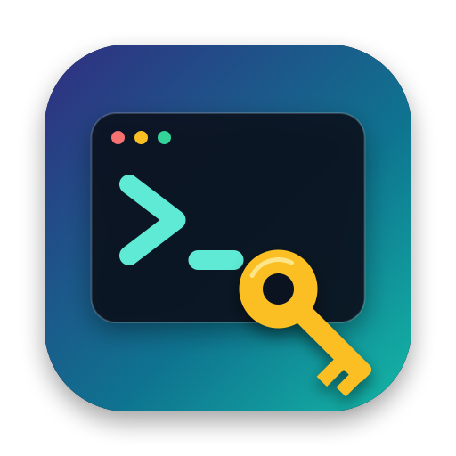

<p align="center">
  
</p>

<h1 align="center">HostKeeper</h1>

<p align="center">
  A free, open-source Mac app for managing your SSH config and SSH keys.<br>
  No subscription, no account, no tracking.
</p>

<p align="center">
  <a href="https://github.com/EricRWilson/HostKeeper/releases/latest"><b>Download the latest version</b></a>
</p>

---

HostKeeper edits `~/.ssh/config`, the file the `ssh` command built into macOS reads to know your servers. Add a host once, then connect with just `ssh myserver`. HostKeeper only edits that file, so `ssh` keeps working whether HostKeeper is open or not.

## Features

- **Hosts:** edit HostName, User, Port, key, ProxyJump and any other ssh option with a simple form. Hover any option to see what it does.
- **Folders and tags:** organize hosts into folders, label hosts and keys with colored tags, and group the sidebar by folder or by tag.
- **Search:** filter by name, address, user, notes or tags. Type `#prod` to show only things tagged prod.
- **SSH keys:** see every key in `~/.ssh` with its fingerprint. Generate, import, copy public keys, add keys to your macOS Keychain, and fix unsafe file permissions.
- **Connect and test:** open a host in Terminal, test that key login works, or install your public key on a server with one click.
- **Safe saving:** ssh checks every change before it's written, your comments and formatting are kept exactly, and every save keeps a backup you can restore.
- **Menu bar:** connect to any host from the menu bar.
- **Built-in help:** a guide to every feature and plain-language explanations of SSH options.
- **Automatic updates:** new versions install themselves after you approve them.

## Install

### With Homebrew

```bash
brew tap ericrwilson/hostkeeper https://github.com/EricRWilson/HostKeeper
```

```bash
brew trust ericrwilson/hostkeeper
```

```bash
brew install --cask hostkeeper
```

`brew trust` is needed because Homebrew only loads apps from taps you've approved. The first time you open HostKeeper, macOS blocks it; see step 3 below.

### By download

1. Download **HostKeeper-x.y.z.dmg** from the [latest release](https://github.com/EricRWilson/HostKeeper/releases/latest).
2. Open the DMG and drag **HostKeeper** into **Applications**.
3. Open HostKeeper from Applications. The first time, macOS blocks it, because the app isn't signed with a paid Apple Developer ID:
   - Click **Done** (not Move to Trash).
   - Open **System Settings → Privacy & Security**, scroll down, and click **Open Anyway** next to the HostKeeper message. Confirm with your password.

   You only need to do this once. Or, if you prefer Terminal:

   ```bash
   xattr -dr com.apple.quarantine /Applications/HostKeeper.app
   ```

Requires macOS 14 Sonoma or later. Runs natively on Apple Silicon and Intel Macs.

## Updates

HostKeeper checks for a new version once a day. When there is one, it shows what's new and installs it after you click **Install Update**. Your hosts, folders, tags and backups are kept. To check right away, choose **HostKeeper → Check for Updates…**. To turn off automatic checks, open **HostKeeper → Settings**.

- **Homebrew:** `brew upgrade --cask hostkeeper` also works.
- **Upgrading from 1.3.0:** that version can't update itself, so download the latest version once by hand. Updates are automatic from then on.

Every update is signed, and HostKeeper refuses any download that isn't signed with the project's key.

## Verify your download

Every release is built by GitHub Actions straight from this repository, never on someone's laptop, and GitHub signs a record of exactly which files it built.

**Check the build record** (needs the [GitHub CLI](https://cli.github.com)):

```bash
gh attestation verify HostKeeper-1.4.1.dmg --repo EricRWilson/HostKeeper
```

A passing check proves the file is byte-for-byte what this repository's release workflow built, and shows the commit it came from.

**Or compare checksums.** Each release lists SHA-256 checksums in its notes and in `SHA256SUMS.txt`. Run this in the folder you downloaded to, and check the result matches:

```bash
shasum -a 256 HostKeeper-1.4.1.dmg
```

Use the version number of the file you downloaded. Releases before 1.4.1 don't have these.

Updates installed from inside the app are checked automatically: HostKeeper refuses any update that isn't signed with the project's key.

## Is it safe?

HostKeeper is fully open source, so you can read every line or [build it yourself](docs/DEVELOPMENT.md). It only goes online to check GitHub for updates and when you click Connect or Test, and it never sends your data anywhere. Before every save it keeps a backup in `~/.ssh/hostkeeper-backups`.

## How folders, tags and notes are stored

They're saved as comments inside your config, which `ssh` ignores, so they travel with the file:

```
Host web
    # hostkeeper:folder Work
    # hostkeeper:tags prod, linux
    # hostkeeper:note Main production server
    HostName 203.0.113.10
    User deploy
```

## Building from source

```bash
git clone https://github.com/EricRWilson/HostKeeper.git
cd HostKeeper
./build-app.sh --app-only
open build/HostKeeper.app
```

Development builds use a practice config instead of your real `~/.ssh`. See [docs/DEVELOPMENT.md](docs/DEVELOPMENT.md) for the full workflow.

## License

[MIT](LICENSE). Free to use, change and share.
